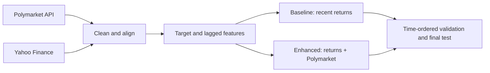
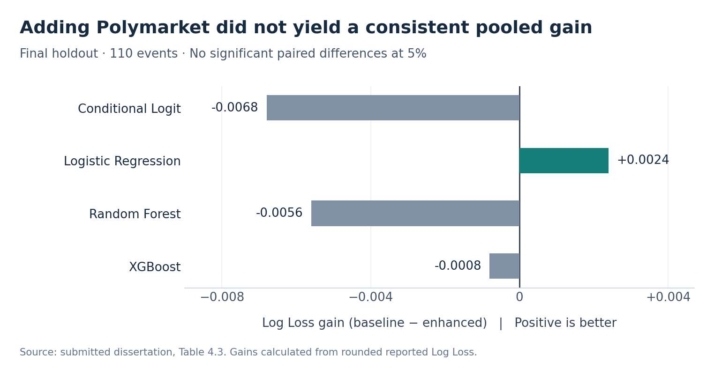
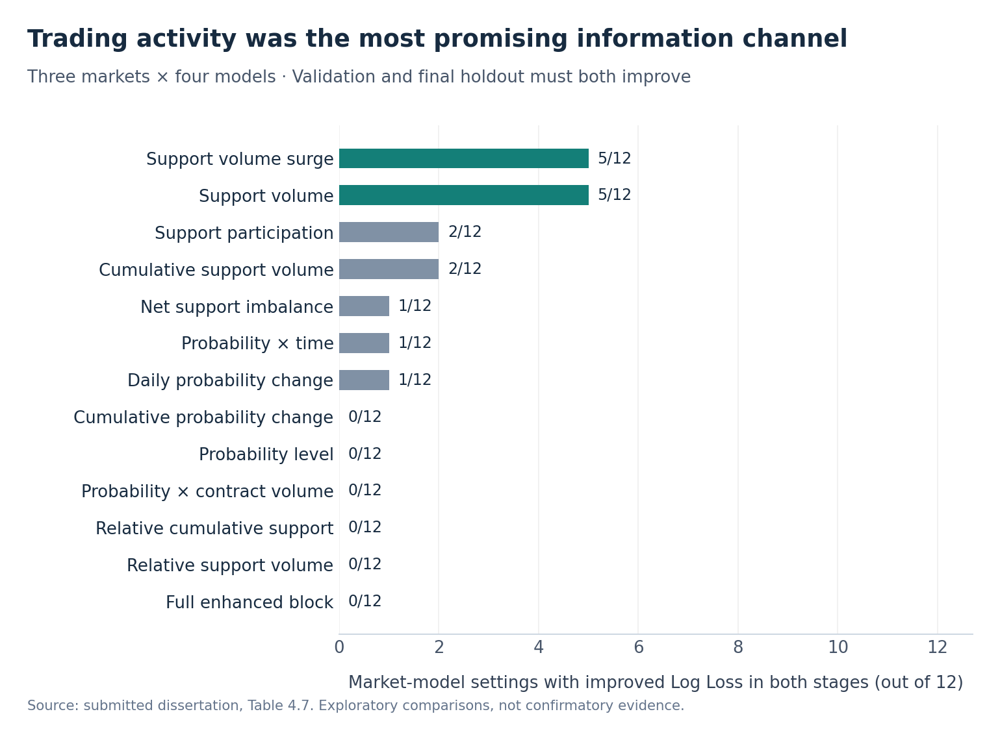

# Do Prediction Market Signals Improve Short-Term Asset Forecasts?

**MSc Business Analytics dissertation | Kingston University London | 2026**
Soheil Esteki

**In short**

- **Business question:** Is a new external data source worth adding to an existing forecast?
- **Test case:** Polymarket prediction-market data, added to a forecast of which asset (Bitcoin, Gold or the S&P 500) performs best over the next trading period.
- **Data:** 428 forecast events (1,012 rows) built from 14,054 Polymarket trades and daily prices, collected through APIs and Yahoo Finance, July 2025 to August 2026.
- **Approach:** Python. The current forecast (recent performance only) compared with an enhanced forecast (plus the new data) across four model types, tested in time order on later periods the models had not seen.
- **Answer:** No. The new data did not reliably improve forecasts, and no difference was statistically significant. One short-term gain looked strong but was no better than a simple "always pick Gold" rule. Recent trading volume was the most promising part of the data, helping in 5 of 12 settings.
- **Recommendation:** Do not add the full data source. If it is revisited, test only the trading-volume signals, on a longer period.

**Why this is relevant to commercial analysis:** the same question comes up when deciding whether to add a new driver to a sales or demand forecast, for example market data, promotions or a new data subscription. This project shows the process: set a clear baseline, add one change at a time, test on later periods, and keep the change only if it helps.

**Skills:** Python (pandas, scikit-learn, XGBoost, statsmodels), API data collection, combining and cleaning data from several sources, feature engineering, forecast evaluation and benchmarking, Excel, clear reporting of results.

---

## 1. Project overview

[Polymarket](https://polymarket.com) is a prediction market where people trade on the outcome of future events. Three of its contracts asked which asset would perform best by the end of the year: Bitcoin vs Gold (2025), Bitcoin vs Gold (2026) and Bitcoin vs Gold vs S&P 500 (2026).

I tested whether the prices and trading activity in these contracts help predict a different, shorter-term question: **which asset will perform best over the next common trading period**, beyond what recent returns already tell us.

Research questions:

1. Does Polymarket information improve short-term forecasts of the best-performing asset beyond recent financial returns?
2. Which types of Polymarket information, if any, add value?

This project measures forecast quality, not trading profit. It does not test or suggest a trading strategy.

## 2. Data

| Contract | Model-ready period | Events | Rows |
| --- | --- | ---: | ---: |
| Bitcoin vs Gold 2025 | 10 Jul to 30 Dec 2025 | 121 | 242 |
| Bitcoin vs Gold 2026 | 2 Jan to 10 Aug 2026 | 151 | 302 |
| Bitcoin vs Gold vs S&P 500 2026 | 24 Dec 2025 to 10 Aug 2026 | 156 | 468 |
| **Total** | **10 Jul 2025 to 10 Aug 2026** | **428** | **1,012** |

- **Polymarket:** daily probabilities and 14,054 historical trades, collected through the Gamma, CLOB and trades APIs.
- **Financial prices:** daily closing prices from Yahoo Finance (`BTC-USD`, `GC=F`, `^GSPC`).
- Each event is one market on one date, with two or three possible winners and exactly one actual winner.
- Prices are aligned to dates when all assets in the event have a closing price.
- All Polymarket features are lagged, so they only use information available before the forecast date.

## 3. Method

**Features**

| Information | Feature | Baseline | Enhanced |
| --- | --- | :---: | :---: |
| Recent returns | Last three log returns | ✓ | ✓ |
| Probability | Lagged Polymarket probability | | ✓ |
| Probability change | Lagged one-day change | | ✓ |
| Contract timing | Probability × time to resolution | | ✓ |
| Trading activity | Log cumulative support volume | | ✓ |
| Trading direction | Net support imbalance | | ✓ |
| Contract timing | Time to resolution | | ML models only |

**Models:** conditional logit was the main model, because it predicts the chance of each option winning within the same event. Logistic regression, random forest and XGBoost were used to check that the conclusion did not depend on one model type.

**Evaluation**

| Stage | Period | Events |
| --- | --- | ---: |
| Development (four expanding-window validation folds) | 10 Jul 2025 to 20 May 2026 | 318 |
| Final test (kept back) | 21 May to 10 Aug 2026 | 110 |

- Splits follow time order, never random, so the models never learn from the future.
- Settings were chosen on validation results only, never on the final test.
- The main measure was **log loss** (lower is better), with Brier score and accuracy as support.
- Baseline and enhanced models were compared with HAC-adjusted tests, which allow for related results on nearby dates.

## 4. Results

### Did adding Polymarket data improve forecasts?

| Model | Baseline log loss | Enhanced log loss | p-value |
| --- | ---: | ---: | ---: |
| Conditional logit | 0.8896 | 0.8964 | 0.370 |
| Logistic regression | 0.8927 | 0.8903 | 0.840 |
| Random forest | 0.8885 | 0.8941 | 0.435 |
| XGBoost | 0.8962 | 0.8970 | 0.946 |

No model improved in both validation and the final test, and no difference was significant at 5%.

**One exception, checked carefully:** in the Bitcoin vs Gold 2025 contract (25 final-test events), the enhanced random forest raised accuracy from 48% to 64% (p = 0.038). However, it did worse earlier in the same contract, and a simple "always pick Gold" rule already reached 60%. I treat this as a result specific to that period, not a reliable advantage.

### Which information was most useful?

I added each Polymarket feature to the baseline one at a time, across 3 markets and 4 models (12 settings).

Support volume and support-volume surge each improved results in both validation and the final test in 5 of 12 settings. The full enhanced set did so in none. Recent trading activity looks more useful than the probability itself, but no feature was reliable across all settings.

## 5. Limitations

- Only three contracts and one period (2025 to 2026), so the results may not hold elsewhere.
- The Polymarket contracts forecast a year-end winner, while my target is the next-period winner.
- Daily data may miss faster information. The 2026 contracts overlap, so their events are not fully independent.
- The feature tests are exploratory and were not adjusted for multiple comparisons.

## 6. Repository structure

| Folder | Contents |
| --- | --- |
| [`notebooks/1_data_preparation/`](notebooks/1_data_preparation/) | Six notebooks: API collection, cleaning, alignment and feature engineering |
| [`notebooks/2_modelling/`](notebooks/2_modelling/) | Five notebooks: main models, market checks, feature tests and timing analysis |
| [`data/`](data/) | Final model-ready dataset |
| [`results/`](results/) | Five Excel workbooks with the full evaluation results |
| [`figures/`](figures/) | Charts used in this README |
| [`docs/`](docs/) | Full dissertation (PDF) |

## 7. How to run

The notebooks were built in Google Colab. To run them locally, change the `/content/` file paths to your own folder and skip the Colab upload and download cells.

1. Install the packages: `pip install -r requirements.txt`
2. Put `data/Final_Competitive_Markets_MODEL_READY_with_CORRECTED_PM_Trading_Features.xlsx` in the notebook's working folder (`/content/` in Colab).
3. Run `01_Conditional_Logit`, `02_Traditional_ML` and `03_Market_Specific_Robustness`.
4. Notebooks `04` and `05` also need `results/Market_Specific_Robustness_All_Models_Results.xlsx` (or the output of notebook 03).

The data preparation notebooks show how the dataset was built. They need the original raw API downloads, which are not included here, and live API calls will return newer data than the dissertation used. See the [data preparation guide](notebooks/1_data_preparation/README.md).

## 8. Reproducibility note

In November 2026 I re-ran all five modelling notebooks from the final dataset with the package versions in `requirements.txt`. Notebooks 01 to 03 reproduced the dissertation results exactly. Notebooks 04 and 05 reproduced the reported tables, with only very small decimal differences in some event-level values.

The original modelling code is kept, with saved outputs cleared. Notebook 06 in data preparation was rebuilt after submission from the dissertation method and the archived data, because the original file was lost. Its check against the saved daily activity data matched, but the full raw-trade pipeline has not been re-run.
